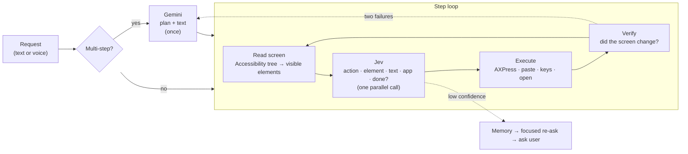

# AgentP

**A fast computer-use agent for macOS.** Tell it what you want in plain language, by keyboard or voice, and it operates your Mac's apps and websites for you.

AgentP splits the work between two models. A fast LLM (**Gemini**) *thinks once*: it plans the request and writes any text that needs to be typed. [**Jev**](https://docs.typesafe.ai) (TypeSafe System One) *acts many times*: at every step it reads the screen and picks the right element in about half a second. Actions are executed natively through the macOS Accessibility API, with no screenshots and no pixel guessing.

```
› message Alex on whatsapp that I'm on my way
  plan:
    1. open_app: Open WhatsApp (WhatsApp)
    2. click: Open the chat with Alex
    3. type: Type the message ← 'On my way!'
    4. enter: Press Enter to send
  1. open_app → WhatsApp
  2. click    → button: Alex [left]
  3. type     → TEXT BOX: Compose message [bottom] ← 'On my way!'
  4. enter    ⚠ Send? (Y/n)
```

## Highlights

- **Fast per-step decisions:** median **0.64 s** per step with Jev, about 4× faster than a fast LLM making the same choice ([benchmark](#benchmark)).
- **General by design:** no app-specific code. The same loop drives WhatsApp, Chrome, Gmail, Google Cloud Console, VS Code, Spotify, Notes and any app that exposes an accessibility tree.
- **Plans and writes:** multi-step tasks, messages composed from intent, and research with on-screen summarization (`research X and write a summary in Notes`).
- **Answers questions directly:** questions are answered in the panel in about a second, with sources, instead of opening a browser. Jev decides whether a request is a question or a task, and whether it needs current facts (then the answer comes from Google Search).
- **Understands who you mean:** names like `mkbhd` or `mr beast` are resolved on the web to the well-known person, channel or brand and their official pages, and remembered for next time. Genuinely ambiguous requests get a short "which one?" instead of a guess.
- **Voice-first panel:** press ⌥Space anywhere and dictate. The panel never steals focus, so the agent starts from the app you are in.
- **Safe by default:** anything that can send, delete, pay or quit asks first and shows exactly what will happen.
- **Learns from use:** remembers your corrections and successful paths, and gets faster on repeated tasks.
- **Measurable:** with recording turned on (`AGENTP_RECORD=1`), `eval.py` replays decisions on real screens to measure the accuracy and latency of any change or model.

## Architecture



**0. Question or task?** For longer requests Jev classifies the request (task / question about the screen / general question, and whether it needs current facts) in parallel with planning and screen reading, so tasks lose no time. Short questions are recognized in Jev's first decision. General questions never open a browser: a quick answer without search is started speculatively for anything that looks like a question and shown if Jev agrees; questions that need current facts (news, results, prices) are answered with Google Search, streamed, with source links.

**1. Plan (Gemini, once per request).** Multi-step requests are broken into high-level steps, and the exact text to type is written by the model, with dictation errors fixed. In parallel, a fast model with Google Search resolves the people, creators, channels or brands the request names (`mkbhd` → Marques Brownlee, `youtube.com/@mkbhd`); if it finds something new, the plan is rewritten with those facts, and the facts are remembered so the next request with that name is planned correctly right away. Handles and URLs are never guessed. If the requested app is not installed, the planner says so and asks before using an alternative. Single-action commands (`open youtube`) skip planning entirely.

**2. Read the screen.** The focused window's accessibility tree is turned into a numbered list of *visible* buttons, links, rows, text boxes and menu items. Each entry carries its position in the window (`top / left / center / right / bottom`). The window title, the browser URL and the focused field (with its content) are added as context.

**3. Decide (Jev, every step).** Jev chooses rather than generates, so every decision is a choice question. One call asks all of them in parallel: *which action, which element, which text, which app or site, which plan step, is the request done?* Jev's calibrated probabilities drive the rest of the loop:
- If an action cannot be carried out, the next most likely valid one is taken, with no extra call.
- If element confidence is low, the agent checks memory first, then asks Jev again with the top 6 candidates in detail, and only then asks the user.

**4. Act and verify.** Elements are pressed directly (`AXPress`); web and Electron elements that ignore it get a real click at their exact on-screen position. Text is pasted and works with any language and emoji. After each action the agent waits for the page to finish loading and the screen to settle. If nothing changed, that element is removed from the candidates for the next step. Two failures trigger one re-plan.

### Actions

| Action | What it does |
|---|---|
| `open_app` / `quit_app` | Launch, focus or quit an application (matched by name or bundle id) |
| `open_url` | Open a site; names resolve to domains, multi-word names to the best match |
| `click` | Press a button, link, chat, tab, menu item or search result |
| `type` | Write into a text box (planned text or a span of the command) |
| `enter` / `escape` / `scroll` / `back` | Submit, dismiss, page down, navigate back (browser-aware) |
| `shortcut` | Close / open / switch tabs, new window, save, open file, refresh, find, copy, paste, undo, zoom… |
| `wait` | Wait until a page loads or another app (e.g. a coding agent) finishes working |
| `read` / `summarize` | Answer questions from the screen; `summarize` uses Gemini and speaks the result, and `{answer}` inserts it into a later typed step |
| `answer` | Answer a general question in words, without using the computer |
| `system` | Volume, mute, dark mode, screen lock |

## Functional testing

Give AgentP a site and it tests it the way a QA engineer would, with no script to write:

```bash
./run.sh --test example.com                       # or in the panel: "test example.com"
./run.sh --test https://shop.example.com --pages 8 --minutes 20 --no-submit
```

For each page, starting from the address and staying on that site:

1. **Read the page:** headings, links, buttons, fields and open menus, including content below the fold.
2. **Automatic checks:** HTTP errors, error pages ("Something went wrong", 404/500), slow loads, broken same-site links, controls that do nothing when used.
3. **Gemini proposes tests** for the page's core features: search, filters, sorting, forms with valid and invalid input, navigation, tabs. Each test has concrete steps and one observable expected result.
4. **AgentP runs the steps** with the normal agent loop, and **Jev checks the expected result** on screen (Gemini decides only when Jev is unsure).
5. **Go deeper** into the most important unvisited pages.

Safety: made-up test data only; never pays, buys, deletes, logs out or contacts anyone; never leaves the site. Form submission is asked once at the start (`--no-submit` tests validation only).

The report goes to `~/.agentp/qa/<time>-<site>/`: `report.html` (issues by severity, every test with its steps, expected result, what the agent did and a screenshot of failures), `results.json` and `junit.xml` for CI. The exit code is non-zero when a test fails or a high-severity issue is found.

## Benchmark

Per-step decision quality on **85 steps recorded during real use** (WhatsApp, Chrome, Gmail, Google Cloud, Medium, VS Code, Notes…). Each recorded screen is replayed and the model makes the same choice the agent faced live; no app is touched. Ground truth is the steps of requests that finished successfully plus the user's own corrections.

| Per-step chooser | Correct step | Correct action | Median latency | p90 latency |
|---|---|---|---|---|
| **Jev** (TypeSafe System One) | **85.9%** | **90.6%** | **642 ms** | **1.2 s** |
| Gemini 3.8 Flash | 71.8% | 75.3% | 2,495 ms | 5.1 s |

Planning with Gemini runs once per multi-step request (median 2.6 s over 18 plans). Short commands need no plan at all.

Reproduce on your own usage: start AgentP with `AGENTP_RECORD=1 ./run.sh` to record steps under `~/.agentp/records/`, then:

```bash
.venv/bin/python eval.py -v                 # Jev, show the misses
.venv/bin/python eval.py --engine gemini    # same steps, Gemini chooses
```

## Getting started

```bash
git clone https://github.com/omerfeyzioglu/agentp-macos.git
cd agentp-macos
./run.sh
```

Or double-click **`AgentP.command`** in Finder.

That's it:

1. **First run** sets everything up by itself (about two minutes, once). If your Mac has no Python 3.10+, it tells you the one command to get it.
2. **Allow one permission** when System Settings opens: *Privacy & Security → Accessibility* → turn on **Terminal** (or the app you started it from). Quit it with ⌘Q, reopen, run `./run.sh` again.
3. **Paste your two API keys** in the panel and press Save:
   - **TypeSafe** (Jev, every on-screen decision): [docs.typesafe.ai](https://docs.typesafe.ai)
   - **Google Gemini** (planning, writing, answers): [aistudio.google.com/apikey](https://aistudio.google.com/apikey)

Then press **⌥Space** anywhere and type, or press 🌐 twice to speak (turn on *System Settings → Keyboard → Dictation* for voice).

Keys stay on your Mac only (`~/.agentp/config.json`, readable by you only) and usage is billed to your own TypeSafe and Google accounts. Change them anytime from the menu bar **P → API Keys…**.

Advanced settings (not needed to get started): `GEMINI_MODEL` (planning, default `gemini-flash-latest`), `GEMINI_LOOKUP_MODEL` (name lookups with Google Search, default `gemini-flash-lite-latest`), `GEMINI_ANSWER_MODEL` (answers to questions, default `gemini-flash-lite-latest`), `AGENTP_GROUNDING=0` to turn web lookups off.

## Usage

```bash
./run.sh                         # panel: ⌥Space anywhere, 🌐🌐 to dictate
./run.sh --terminal              # terminal interface
./run.sh --terminal --dry-run    # show what it would do, do nothing
./run.sh --terminal --setup      # change your API keys
```

| Try | What happens |
|---|---|
| `open whatsapp` → `open the chat with Alex` → `type hello and send` | Opens the app and the chat, types, sends after confirmation |
| `tell mom I'll be home late on whatsapp` | Plans, writes a natural message, sends after confirmation |
| `open instagram` → `go to messages` | Opens the site and navigates to DMs |
| `search jev agent on google` → `open the github project` | Searches, then follows the result |
| `research jev agent and write a summary in notes` | Searches, opens a result, summarizes, writes it into Notes |
| `what is the latest email` | Finds the answer on screen and reads it aloud |
| `how tall is mount everest`, `usd to eur rate` | Answered in the panel with sources; current facts come from Google Search |
| `close this tab`, `go back`, `scroll down`, `close chrome` | Shortcuts, navigation, quitting apps |
| `test example.com` | Explores the site, runs functional tests, opens a QA report |

In-session commands: `new` clears context, `!wrong` marks the last request as wrong (it is removed from memory and excluded from evaluation), `q` quits. The menu bar **P** icon offers the same.

## Memory & data

AgentP improves with use:
- **User picks:** when you answer "which one?", the choice is remembered for similar requests in the same app.
- **Successful paths:** finished requests are stored. For a similar request Jev receives the earlier steps as a hint, and the extra "done?" check is skipped when the steps match.

AgentP stores only two files, on your Mac, under `~/.agentp/`: `config.json` (your API keys) and `memory.json` (learned picks, successful paths and who names refer to). Nothing else is written to disk.

What leaves your Mac, and to whom:
- **TypeSafe (Jev):** your request and the visible text of the app you are working in (element labels, window title, page URL), at every step.
- **Google (Gemini):** your request and recent requests for planning and answers; the visible page text when you ask for a summary; names you mention, for web lookups.

No screenshots are taken and nothing is sent anywhere else. Answers that use Google Search show their sources and the Google Search suggestions they were based on.

## Project layout

```
agent.py                agent loop: screen reading, decisions, actions, terminal UI
ui.py                   ⌥Space panel, dictation, confirmations, menu bar icon
planner.py              Gemini: planning, writing, answers, name lookups, eval baseline
memory.py               learned picks, successful paths, who names refer to
config.py               your API keys, stored on your Mac only
qa.py                   exploratory functional testing of websites, QA reports
eval.py                 developers: replay recorded steps, measure accuracy, latency and tokens
run.sh, AgentP.command  one-command setup and launch
```

## Roadmap

- **Confidence-gated escalation (System 1 / System 2):** Jev handles every step; only when its confidence is low or the screen does not change, that single step is escalated to a vision-capable frontier model. The aim is frontier-level accuracy at Jev's speed and cost, with escalated decisions written back to memory so they become fast paths. The recorded confidences already allow this trade-off to be measured offline.
- **MCP server:** expose AgentP as a single `mac_do(task)` tool so Claude, ChatGPT or Cursor can delegate whole UI tasks to it, with an end-to-end comparison of time, tokens and success.
- **Faster planning:** a smaller app list in the prompt, planning in parallel with the first screen read, and Flash-Lite as an option.
- **Hands-free mode:** auto-submit after dictation pauses.
- **App bundle:** a signed, notarized `AgentP.app` with permission onboarding, so no terminal is needed.

## Safety

AgentP acts on your Mac with your accounts. Anything that can send, delete, pay, sign out or quit asks first and shows exactly what will happen; typing into a terminal always asks. Text read from web pages and apps is treated as data, never as instructions. Review the confirmations before you accept them.

## License

[MIT](LICENSE)
